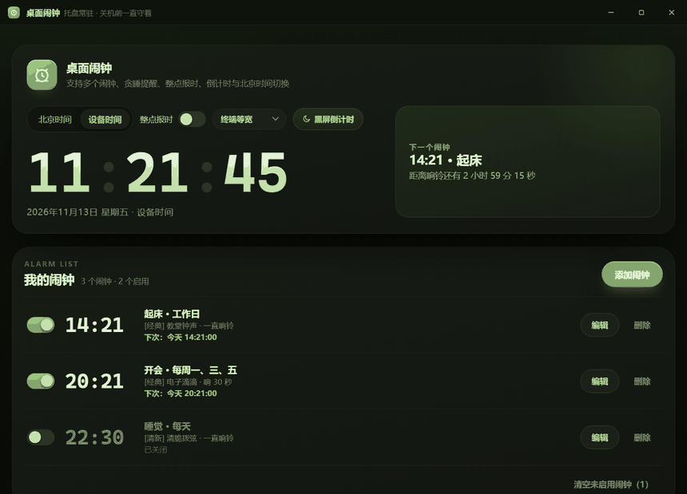

# Desktop Alarm Clock

[中文](README.md) · **English**

A Windows alarm clock that never touches the network. Close the window and it keeps running in the tray; when an alarm fires it forces itself to the front.

**[Try the web version →](https://peijy1226.github.io/desktop-alarm-clock/)** (nothing to install, runs in the browser)



## Install

Grab a build from [Releases](https://github.com/Peijy1226/desktop-alarm-clock/releases) and double-click:

- `DesktopAlarmClock-x.x.x-setup.exe` — installs with Start menu and desktop shortcuts
- `DesktopAlarmClock-x.x.x-portable.exe` — no install, runs from anywhere

Both are single files, no runtime needed.

## Three things worth a closer look

**1. The blackout countdown**

Late at night you just want to know how long until you can sleep. Opening a laptop to check the time is blinding. This mode covers the whole screen in pure black and leaves only red digits, dimming one more step after 12 seconds idle.

The digits scale to fit the screen width, you can switch typefaces from the top-left corner, and `Esc` exits with the window restored to exactly its previous size.

**2. Nine digit typefaces that actually match in size**

A common problem with swappable numerals: they come out wildly different sizes, because typefaces are drawn at different heights — Impact sits low, seven-segment fills the full em box. Here each typeface is rendered to a canvas, scanned row by row to find the real pixel height, and the font size is back-calculated from that. Measured across all nine, the rendered heights differ by no more than 2 pixels.

The seven-segment and dot-matrix options aren't fonts at all — they're drawn as SVG, so they look identical on every machine.

**3. Chimes: 17 synthesized, plus room for your own**

The 17 built-in sounds are all built live with Web Audio — oscillators and envelopes, no samples. The program ships zero mp3 files, which is why it installs at 76MB (nearly all of that being Electron).

For your own music, just drop a file in. **One track, up to 100MB** — enough for lossless FLAC or a high-resolution master. MP3, WAV, FLAC, AAC, M4A, OGG and OPUS all work. Unsupported formats are still accepted and stored; if the browser can't decode one, you're told right away and it falls back to the default chime instead of ringing silent.

Audio is stored as raw binary in a local database — no transcoding, no compression. A 95MB file lands in about a second and plays without stutter.

## Everything else

Alarms support six repeat modes: once, daily, a specific date, weekdays, Chinese public holidays, or any set of weekdays. A repeating alarm you don't want tomorrow can be skipped just once, without turning it off and back on.

The desktop build also keeps the window in the tray on close, starts with Windows, blocks sleep while alarms are pending, and flashes the taskbar on fire. All data stays in `%APPDATA%`; not a byte leaves the machine.

## One deliberate trade-off

The app **disables GPU acceleration**.

NVIDIA, Steam, and Discord all draw their FPS overlays by injecting into the GPU pipeline, which no amount of window stacking can cover. With no GPU surface to inject into, they have nowhere to draw — at the cost of compositing the UI on the CPU.

The measured cost is small: about 1.7% of one core while the window is open, roughly 2% minimized, and around 400MB of memory. That memory figure is Electron's floor and has nothing to do with the GPU setting.

## Build from source

```bash
cd desktop
npm install
npm start
```

To package (PowerShell):

```powershell
cd desktop
$env:CSC_IDENTITY_AUTO_DISCOVERY = "false"
npx electron-builder --win nsis portable --x64
```

Output lands in `desktop/release/`.

## Where the code lives

```
index.html            the entire web version, single file
desktop/main.js       Electron main process: window, tray, notifications, power
desktop/preload.js    the narrow API exposed to the renderer
desktop/app/          desktop page (generated, don't edit)
desktop/build/        icon generation and web-to-desktop conversion
```

`desktop/app/index.html` is produced from the root `index.html`, so after changing the web version run:

```bash
cd desktop && python build/make_desktop_app.py
```

The conversion script does four things: applies the custom title bar, removes the browser audio prompt, reports ring events to the main process, and injects the desktop settings panel.

Problems encountered along the way are written up separately in [NOTES.md](NOTES.md) — fullscreen sizing, SVG fills, and font measurement are the ones that keep coming back.

## Known rough edges

If autostart is off, alarms won't fire after a reboot — the program isn't running. Deep sleep is also silent, though alarms missed during sleep are caught up within 3 minutes of waking. The Chinese holiday table is hand-coded for 2026 and will need updating next year.

## License

MIT
