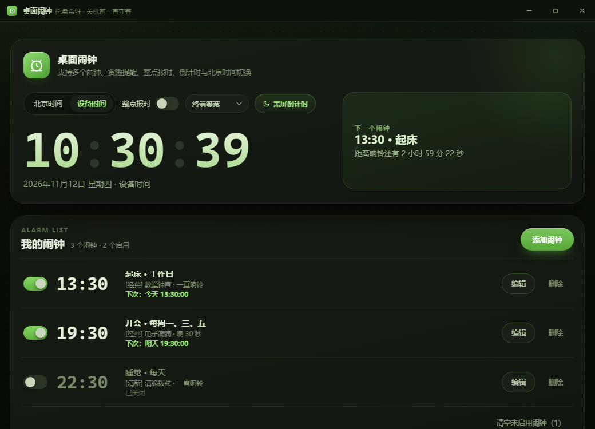
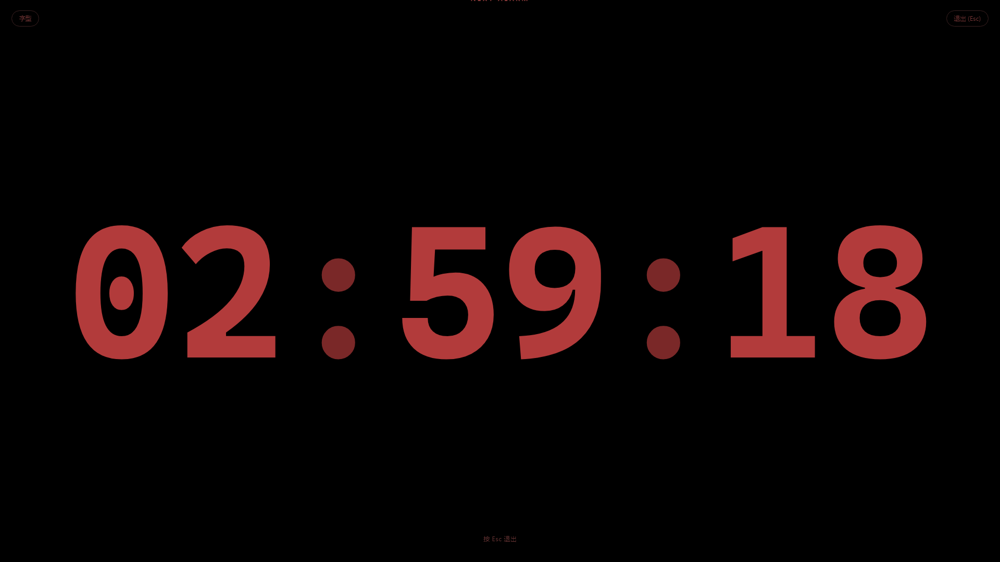
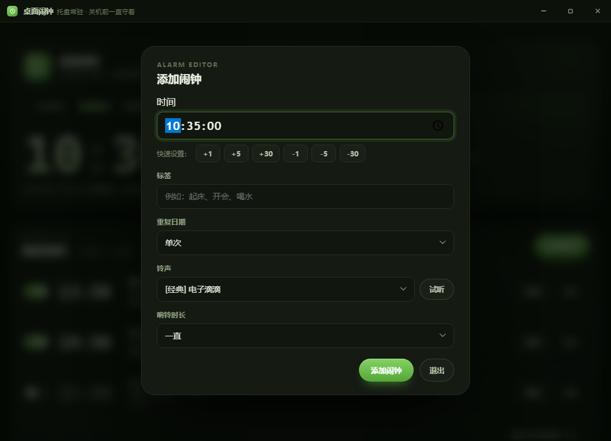

# 桌面闹钟 🔔

一个纯本地、无广告、不联网的桌面闹钟。深色主题，9 种数字字型，带全屏黑屏倒计时。

网页版单文件，桌面版基于 Electron。铃声全部实时合成，不含任何音频文件。



<details>
<summary>更多截图</summary>

**黑屏倒计时**



**添加闹钟**



</details>

## 功能

**闹钟**
- 多闹钟，独立开关 / 编辑 / 删除
- 时间精确到秒
- 6 种重复规则：单次 / 每天 / 指定日期 / 工作日 / 节假日 / 自定义星期
- 标签自定义
- 响铃时长：一直 / 10s / 30s / 1m / 5m / 10m
- 贪睡 5 分钟
- 关闭重复闹钟时可选择「只跳过这一次」

**铃声**
- 17 个内置铃声，覆盖经典 / 劲爆 / 清新 / 舒缓 / 其它五类
- 全部用 Web Audio 实时合成（振荡器 + 包络 + 噪声 + 滤波），不占体积、不联网
- 支持上传自定义音频（≤1.5MB，存本地）

**显示**
- 大号时钟，**9 种数字字型**：现代无衬线 / 科幻 HUD / 终端等宽 / 极简细体 / 古典衬线 / 手写艺术 / 冲击粗黑 / 七段数码管 / 点阵屏
  - 每种字型用 canvas 逐像素测量归一化，视觉高度一致
  - 七段数码管和点阵屏是 SVG 现场绘制，不依赖字体
- 北京时间 / 设备时间切换（跨时区不漂移）
- 整点报时（24 个时点任选 + 独立音量）
- **黑屏倒计时**：全屏纯黑，只显示到下次闹钟的剩余时间
  - 宽度自适应，任何字型都不溢出
  - 12 秒无操作自动调暗，6 秒隐藏按钮
  - 可现场切换字型
  - `Esc` 退出，一次即可

**桌面特有**
- 关闭窗口收到托盘，闹钟照常响
- 开机自动启动
- 阻止系统休眠（有启用中的闹钟时）
- 响铃强制置顶 + 任务栏闪烁 + 系统通知
- **关闭 GPU 加速**：NVIDIA / Steam / Discord 的浮层靠注入 GPU 渲染管线绘制，禁用后它们无法覆盖到本窗口

## 安装

### 直接下载

到 [Releases](../../releases) 下载：

| 文件 | 说明 |
|---|---|
| `桌面闹钟-x.x.x-安装程序.exe` | 安装版，带开始菜单和桌面快捷方式 |
| `桌面闹钟-x.x.x-绿色版.exe` | 单文件绿色版，双击即用 |

### 网页版

直接用浏览器打开 `index.html`，无需安装。

> 网页版需要手动点击「点击授权」允许播放音频（浏览器安全策略），桌面版不需要。

## 从源码构建

需要 Node.js 18+。

```bash
cd desktop
npm install
npm start          # 开发模式运行
```

打包：

```bash
# Windows 安装程序
npm run dist:installer

# Windows 绿色版
npm run dist
```

产物在 `desktop/release/` 或 `desktop/dist/`。

## 项目结构

```
.
├── index.html                    网页版（单文件，全部逻辑在其中）
├── desktop/
│   ├── main.js                   Electron 主进程：窗口 / 托盘 / 通知 / 休眠控制
│   ├── preload.js                预加载脚本（contextIsolation 下暴露受限 API）
│   ├── package.json              构建配置
│   ├── app/index.html            桌面版页面（由 build 脚本从网页版生成）
│   └── build/
│       ├── icon.ico  icon.png    应用图标
│       ├── make_icon.py          图标生成脚本（Pillow）
│       └── make_desktop_app.py   网页版 → 桌面版转换脚本
├── LICENSE
└── README.md
```

### 改完网页版后同步到桌面版

```bash
cd desktop
python build/make_desktop_app.py
```

这个脚本会：
1. 注入自定义标题栏（无边框窗口需要）
2. 隐藏浏览器音频授权横幅（桌面环境不需要）
3. 响铃/状态事件同步给主进程
4. 加入「桌面设置」面板

## 技术实现

### 时间轴

统一「墙上时间」概念：

```js
nowWall() = Date.now() + shiftMs()
```

北京时间模式下 `shiftMs = 480分钟 + 本地时区偏移`。所有调度、比较、显示都在这条时间轴上，避免时区换算误差。

### 触发判定

`dueOccurrence()` 检查「当前时刻是否落在某个闹钟的目标秒内」，比 `nextOccurrence` 更适合每秒轮询。

自适应容差 `fireTolerance()`：正常节拍约 2 秒；标签页被浏览器挂起后按实际间隔放宽（上限 3 分钟）。保证后台补响，又不会让新增的旧时间闹钟立刻误响。

每个闹钟记 `lastFireKey = id@时间戳` 去重，同一时刻只响一次。

### 音频

单个 `AudioContext` + 主音量 `GainNode`。每个铃声是一个 `build(t0, dest)` 函数，向时间轴排音。

循环播放用 180ms 前瞻调度器 `pump()` 滚动续排，避免 `setTimeout` 抖动。

### 字型归一化

不同字体的数字高度差异很大（Impact 矮、七段数码管占满全高）。做法：

1. 基准字号下用 canvas 实际绘制数字
2. 逐行扫描像素，得到真实高度
3. 反算 `font-size = 目标高度 / 实测高度 × 基准字号`
4. 写入 CSS 变量 `--clock-fs`

比 `measureText().actualBoundingBoxAscent` 准 —— 后者对手写体偏差可达 34%。

### 资源占用优化

| 优化项 | 做法 |
|---|---|
| 主循环 | 1 秒一跳，对齐系统秒边界 |
| 后台降频 | 窗口不可见时 3 秒一跳，完全不碰 DOM |
| 冒号闪烁 | CSS 无限动画 → JS 切 class（消除持续合成） |
| 倒计时刷新 | 每 5 秒一次，文本没变不碰 DOM |
| 时钟渲染 | 秒数签名去重 |
| Chromium | 关闭 HTTP 缓存 / 后台网络 / 组件更新 / 同步 / MediaRouter / Translate |
| 进程合并 | 网络服务合进主进程 |

实测（32 核 2560×1440）：
- 窗口显示：**1.7% 单核**（0.05% 全机），内存约 400MB
- 最小化：约 2% 单核，内存约 390MB

内存是 Electron 固有成本，改不了。

### 数据存储

| 内容 | 位置 |
|---|---|
| 闹钟、报时配置、自定义铃声 | `%APPDATA%\桌面闹钟\Local Storage\`（桌面版）<br>浏览器 localStorage（网页版） |
| 桌面配置（自启、托盘等） | `%APPDATA%\桌面闹钟\desktop-config.json` |

localStorage key：
- `naobiao.alarms.v1` — 闹钟列表
- `naobiao.config.v1` — 时间模式、字型、整点报时
- `naobiao.customTones.v1` — 自定义铃声

不联网、不上传。删程序不会自动清掉数据。

## 已知限制

1. **关机 / 重启后闹钟不响**（程序没运行）。开机自启可解决。
2. **电脑深度休眠期间不响**，唤醒后 3 分钟内补响。
3. **内存约 400MB**，Electron 固有成本。
4. 网页版必须保持页面打开；桌面版关窗口会收到托盘，不受影响。
5. 节假日表是手写的 2026 年数据，跨年后需自行补充 `HOLIDAYS` 常量。

## 与在线闹钟站点的区别

原站的铃声是服务器上的 mp3，离线不可用。本项目：

- 铃声改为本地实时合成，不依赖网络
- 数据只存本机，不上传任何服务器
- 界面重新设计，功能对齐并增加桌面能力

## 致谢

- [Electron](https://www.electronjs.org/)
- [electron-builder](https://www.electron.build/)
- 字体来自系统自带（Windows 的 Bahnschrift / Cascadia Mono / Segoe UI / 等）

## License

[MIT](LICENSE)
