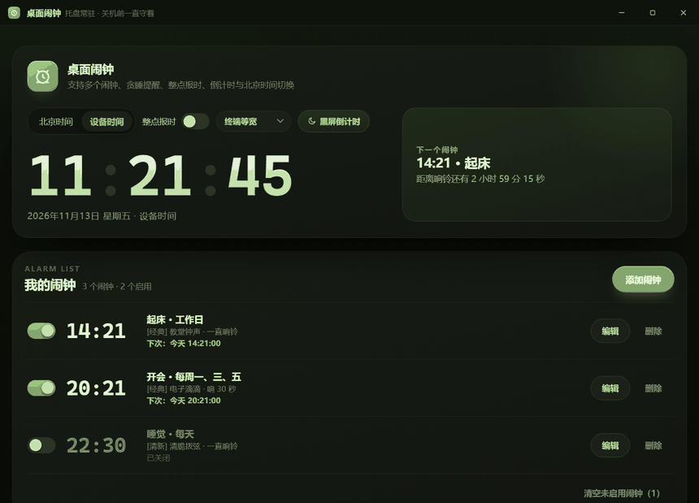

# 桌面闹钟

[](https://github.com/Peijy1226/desktop-alarm-clock/releases)
[](LICENSE)

一个不联网的 Windows 桌面闹钟。关掉窗口它还在托盘里待着，到点了自己跳出来。

**[在线试用 →](https://peijy1226.github.io/desktop-alarm-clock/)** 不用装，浏览器里能跑



## 装

[Releases](https://github.com/Peijy1226/desktop-alarm-clock/releases) 里两个 exe，双击就行：

`-setup.exe` 装到系统里，带开始菜单和桌面快捷方式；`-portable.exe` 免安装，U 盘里也能放着。

都是单文件，不用装 Node.js，不用装运行库。装完 76MB，基本全是 Electron 自己。

不想装软件的话，[网页版](https://peijy1226.github.io/desktop-alarm-clock/) 打开就能用，或者把仓库里的 `index.html` 下载下来双击。

## 为什么会有这个

我晚上躺床上想问电脑"还能睡多久"，睁眼看屏幕太刺眼，摸手机会彻底醒。就想要一个纯黑背景上只有数字的东西。

所以黑屏倒计时做得最久，其他都是围着它顺手加的。

铺满全屏、纯黑、红色数字，12 秒不动自己再暗一档——暗到刚好能看见但不照亮房间。数字跟着屏幕宽度缩，换任何字型都不会被切掉右边。点左上角能就地换字型，`Esc` 一按回去，窗口还是原来那个大小。

## 字型

九种，本来只有一种，越加越多：

现代无衬线、科幻 HUD、终端等宽、极简细体、古典衬线、手写艺术、冲击粗黑，还有两个不是字体的——七段数码管和点阵屏，SVG 画的，任何电脑上长得一模一样。

麻烦在于换了字型数字大小全乱。字体本身的数字高度就不一样，Impact 特别矮，数码管直接顶满字身框，同一个字号能差快一倍。

现在用 canvas 把每种字体的数字真画一遍，逐行扫像素找实际高度，再反推该给多大字号。九种高度差控制在 2 像素以内，肉眼看不出来。

`measureText` 那个 `actualBoundingBoxAscent` 完全没法用，手写体量出来差三分之一。

## 铃声

内置 17 个，全部 Web Audio 现场合成，振荡器加包络，一个音频文件都没有。所以程序小，换铃声也不用等下载。

17 个分五类：经典、劲爆、清新、舒缓、其它。清脆的清脆，闷的闷，都是调出来的。

也可以放自己的歌，最大 **100MB**，无损整轨放得下。MP3、WAV、FLAC、AAC、M4A、OGG、OPUS 都支持。音频原样存，不转码不压缩，95MB 的 WAV 大概一秒入库，播放不带卡。

上传完会立刻验证能不能解码，确保响铃的时候一定有声。

## 闹钟

六种重复方式：单次、每天、指定日期、工作日、法定节假日、自选星期。

重复的闹钟临时不想响，可以只跳过这一次，不用关掉再打开。

时间精确到秒，支持标签、贪睡 5 分钟、响铃时长（一直响 / 10 秒 / 30 秒 / 1 分 / 5 分 / 10 分）。

自己传的铃声不受上面的时长限制。一段三十秒的曲子放完会自动接上，一直响到你点「我知道了」或者「贪睡」，不会放到一半自己安静下来。

整点报时可选，24 个时点任意勾，音量单独调。

## 桌面版比网页版多什么

**关窗口不退出。** 点叉收进托盘，闹钟照响。网页版必须留着标签页，这个区别很大。

**开机自启。** 勾上之后重启电脑也不用管，闹钟一直在。

**有闹钟的时候不让电脑睡。** 这条挺关键——笔记本合盖休眠了，闹钟到点也没人叫。

**到点强制弹到最前**，同时闪任务栏、发系统通知。你在别的窗口打字也会被打断，这才是闹钟该有的样子。

数据全在本机 `%APPDATA%`，一个字节都不往外发。卸载也不会自动删数据，重装还在。

## GPU 加速是关掉的

NVIDIA、Steam、Discord 那些 FPS 浮层不是窗口，是直接往显卡渲染管线里塞东西的，窗口置顶一万层也压不住。

所以干脆让程序不创建任何 GPU 画面，没东西可注入就没东西能盖上来。代价是界面改用 CPU 合成。

量过：开着占单核 1.7% 左右，最小化约 2%，内存 400MB 上下。这个内存是 Electron 的底价，跟这个开关没关系。风扇不会转，笔记本电池也感觉不出来。

---

# 开发备忘

下面是给自己看的，怕两周后忘了。

## 代码结构

```
index.html            网页版全部内容，单文件
desktop/main.js       Electron 主进程：窗口、托盘、通知、休眠
desktop/preload.js    渲染进程能调的受限接口
desktop/app/          桌面版页面（生成的，别手改）
desktop/build/        图标 + 网页版转桌面版
```

`index.html` 是单文件——HTML、CSS、JS、音频合成引擎全在里面。改的时候保持单文件，不拆成独立文件。理由是双击就能用，不用起本地服务器，发给别人也只有一个文件。

## 改代码的流程

只改根目录的 `index.html`，改完必须同步：

```bash
cd desktop && python build/make_desktop_app.py
```

不然桌面版还是旧的。这个我踩过好几次了，改完忘了同步，打包出来一看还是老界面，还以为是没保存。

转换脚本干四件事：套自绘标题栏、去掉浏览器的音频授权提示、把响铃事件报给主进程、插桌面设置面板。

## 本地跑和打包

```bash
cd desktop
npm install
npm start
```

打包：

```powershell
cd desktop
$env:CSC_IDENTITY_AUTO_DISCOVERY="false"
npx electron-builder --win nsis portable --x64
```

不设那个环境变量会报错，说是创建符号链接没权限（`Cannot create symbolic link ... 客户端没有所需的特权`）。反正也没打算签名，跳过就跳过了。没签名的坏处是 Windows 会弹"未知发布者"。

产物在 `desktop/release/`。

## 几个坑

### 关掉 GPU 加速之后，全屏就废了

一开始是为了挡 NVIDIA 那个 overlay。游戏加加的 FPS 数字老是盖在闹钟上面，看着烦。

结果 `app.disableHardwareAcceleration()` 一开，`setFullScreen(true)` 就只改状态不改尺寸了，窗口纹丝不动。查了半天以为是自己调用顺序不对，又怀疑是 Electron 版本问题，最后才想到可能是因为没有 GPU 上下文，全屏那套走不通。

后来不用系统全屏了，直接 `setBounds(display.bounds)` 把窗口拉到整屏，层级设 `screen-saver`。反正视觉上没区别，用户也看不出来。

顺便说，这个方法有个额外好处：不用处理全屏状态机，省一堆事。

### background-clip 和 SVG 打架

主时钟那个渐变字是用 `background-clip:text` 加 `color:transparent` 做的。

后来加七段数码管，SVG 里写了 `fill="currentColor"`，结果整个字型**完全不见**。

一开始以为路径写错了，把 path 单独拿出来渲染是好的。又怀疑 viewBox 不对。折腾了快一小时，偶然把 `currentColor` 换成写死的红色，一下就出来了。

才反应过来 `currentColor` 继承的就是那个 `transparent`。

所以现在 SVG 字型全部写死 fill，一个都不留 currentColor。

### 量字体高度千万别用 measureText

`actualBoundingBoxAscent` 对手写体完全不准。Gabriola 量出来 71px，实际画到屏幕上只有 47px，差了三分之一。

按量出来的算字号，手写体小一大圈，站在旁边一眼就能看出来不对。

改成真的画一遍再扫像素：

```
画到 canvas → 逐行扫 alpha → 第一行到最后一行的高度
```

这个准。但 Gabriola 还有别的问题，它是 OpenType 变体字体，canvas 里画出来的和 DOM 里渲染的根本不是同一个字形。这个没法修，直接换成 Segoe Script 了。少一个字体，但至少九种的高度能对齐。

### 退出全屏窗口会变大

`setFullScreen(false)` 是异步的。你在它后面马上 `setBounds`，系统自己那个"恢复到全屏前尺寸"的动作会把你覆盖掉，窗口就变成最大化了。

还有个坑：别在 fullscreen 状态下设 bounds，会把 Windows 记着的原尺寸冲掉，之后就再也恢复不回去。

现在是等 `leave-full-screen` 事件，然后设一次，再加上一个校验兜底。绕是绕了点，但能跑。

### 黑屏要按两次 Esc

桌面版里 HTML fullscreen 和主进程的 `setFullScreen` 同时在跑，第一下 Esc 被 Chromium 拿去退 HTML 全屏了，得再按一次才退得出来。

判断 `window.desktop.isDesktop`，桌面版就不调 HTML 那套。

### 点阵屏和手写体会超出屏幕

这两个字幅天生比数字宽，按正常字号铺满屏幕，右边会被切掉一截。

加了个 autoFit：先按满配渲染一帧（反正这时候黑屏没人看见），量 `scrollWidth`，超过屏幕 92% 就按比例缩。

92% 这个数是试出来的。100% 有时候边缘会压线，95% 还是有点紧，92% 看着舒服。

### 打出来的包删不掉

Electron 跑起来之后 `app.asar` 是被锁住的。清理 dist 时老报 `Error during a trash operation`。

重启进程没用，必须重启电脑。后来干脆全加 .gitignore 了，眼不见为净，反正也不占仓库。

### 100MB 音频差点把 localStorage 撑爆

原来限制 1.5MB，直接转 base64 塞 localStorage。

把上限提到 100MB 的时候才想起来，localStorage 一共才 5MB 配额。而且是字符串，100MB 在主线程里处理，界面直接卡死。

改成 IndexedDB 了，原生就能存 Blob，不用转码。localStorage 只留个名字和大小当索引。

播放的时候 `URL.createObjectURL` 生成临时地址给 `<audio>`。用完记得 revoke，不然内存里会攒一堆。

顺手加了三个东西：

- `migrateLegacyTones()` 开机自动把旧版那些 base64 搬过去，不然老用户升级上来铃声全没了
- `probeDecodable()` 上传完立刻试着解一下码。FLAC 在老 Chromium 上不行，APE、WMA 这些根本别想。解不了当场告诉用户，别等到闹钟响了才发现没声音
- `playCustom` 里加了个 error 兜底，解不了就回落到 `digital_beep`。宁可响个不好听的，也不能不响

测过 95MB 的 WAV，一秒入库。

### 那个 CSP 警告

控制台一直有个 "Electron Security Warning (Insecure Content-Security-Policy)"。

查了，说是没设 CSP。想加但网页版要单独打开，加了之后有些内联的 SVG data URI 会被拦。

就这么放着了。本地程序不联网，风险不大。

## 改渲染和字型的注意事项

- 主循环 1 秒一次，别加更密的定时器
- 窗口不可见时不碰 DOM
- 文本没变就别重写 innerHTML
- 字型定义在 `ClockFace.STYLES`，每项有 `font` / `weight` / `track` / `glow`，尺寸由 `measureCapHeight()` 自动算，不用手写 font-size
- 加新字型后跑一遍，确保九种的渲染高度仍然一致

## 一堆魔数

代码里到处是 0.92、180 这种数字，隔久了肯定看不懂，记一下：

- **0.92** 黑屏 autoFit 的阈值，超过屏宽 92% 就开始缩
- **180** 音频调度器的前瞻窗口，毫秒。太小学 setTimeout 会抖，太大循环排不满
- **0.8** 调度时往前看多远，秒
- **12** 秒自动调暗
- **6** 秒藏按钮
- **2** 秒到点判定容差，被挂起过就按实际间隔放宽，最多 3 分钟
- **0.72em** SVG 字型的尺寸系数，对应文本数字的 cap height

## 想改但没改

- 节假日表现在是手写的 2026 年，明年得补。本来想接个接口自动拉，但那跟"不联网"这个卖点矛盾，就算了。做个本地 json 也行，懒得弄。
- 想加窗口透明，让闹钟能浮在桌面上。试了一下，关掉 GPU 加速之后 transparent 好像不管用，就放弃了。
- 代码签名太贵，一年好几百刀，一个免费小工具不值当。
- 试过用 CSS 的 `font-variant-numeric` 统一数字宽度，对系统字体管用，对 SVG 那两种没用。两种方案混着更乱，还是回到扫像素。
- 想加"闹钟声音渐强"，响了之后音量慢慢升上来。但 Web Audio 那个 masterGain 和自定义音频的 `<audio>` 是两套东西，得分别处理，嫌麻烦先没做。

## 提交和发版

提交信息用普通中文写就行，不用加 `feat:` `fix:` 那种前缀。

发版：

```bash
git tag v1.0.1
git push origin v1.0.1
```

推上去之后 GitHub Actions 会在 Windows 服务器上自动编译，把两个 exe 传到 Releases，两三分钟。配置在 `.github/workflows/build.yml`，里面 tag 匹配的是 `v*`。

## 环境

Node 18 以上。Python 只是跑图标和同步脚本用的，不装也能开发，只是改不了图标。

| 组件 | 用途 |
|---|---|
| Node.js 18+ | 跑 Electron、打包 |
| Python 3.9+ | `make_desktop_app.py`、`make_icon.py` |
| Pillow | 只有 `make_icon.py` 需要，`pip install pillow` |

## License

MIT
